Presented with [Liz Hare, PhD](https://www.linkedin.com/in/liz-hare-phd-1a50925/) from Dog Genetics, LLC

::: {.callout-tip}

Since this presentation, Liz authored a chapter in the Urban Institute's Do No Harm Guide on Centering Accessibility in Data Visualization. The chapter is titled [Writing Alt Text to Communicate the Meaning in Data Visualizations](https://www.urban.org/sites/default/files/2022-12/Do%20No%20Harm%20Guide%20Centering%20Accessibility%20in%20Data%20Visualization.pdf#Chapter%204). Check it out!

:::

# Abstract

We all aim to use data to tell a compelling story, and many of us enjoy sharing how we got there by open-sourcing our code, but we don't always share our story with everyone. Even kind, supportive, and open communities like the #TidyTuesday R learning community on Twitter has a ways to go before the content shared can be accessible to everyone.

Lived experiences of blind R users tell us that most data visualizations shared for TidyTuesday are inaccessible to screen reading technology because they lack alternative text (i.e. alt text) descriptions. Our goal was to bring this hidden lack of accessibility to the surface by examining the alternative text accompanying data visualizations shared as part of the TidyTuesday social project.

We scraped the alternative text from 6,443 TidyTuesday images posted on Twitter between April 2, 2018 and January 31, 2021. The first image attached to each tweet was considered the primary image and was scraped for alternative text. Manual web inspection revealed the CSS class and HTML element corresponding to the primary image, as well as the attribute containing the alternative text. We used this information and the ROpenSci {RSelenium} package to scrape the alternative text. Our preliminary analysis found that only 2.4% of the images contained a text description entered by the tweet author compared to 84% which were described by default as 'Image.'

This small group of intentional alternative text descriptions had a median word count of 18 (range: 1-170), and a median character count of 83 (range: 8-788). As a reference point, Twitter allows 240 characters in a single tweet and 1,000 characters for image descriptions. This analysis was made possible thanks to a dataset of historical TidyTuesday tweet data collected using the ROpenSci {rtweet} package, and openly available in the [TidyTuesday GitHub repository](https://github.com/rfordatascience/tidytuesday).

We will present during Session 0 on May 4, 2021: [Crowdcast Link](https://crowdcast.io/e/csvconf6-0-session-0)

# Transcript

An abridged transcript is provided below as an alternative to the video. It was created locally using MacWhisper and has been edited for clarity.

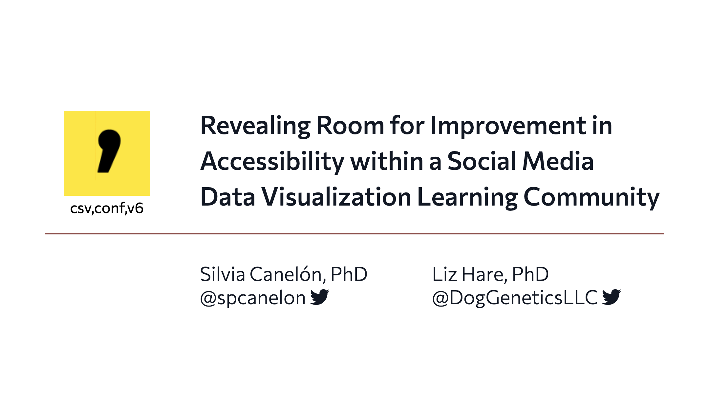{fig-alt=""}

**Silvia Canelón:**

Thanks for the opportunity to talk with you today about an online data visualization learning community and what we found out about how accessible it is for blind people using screen reading software.

## Who are we?

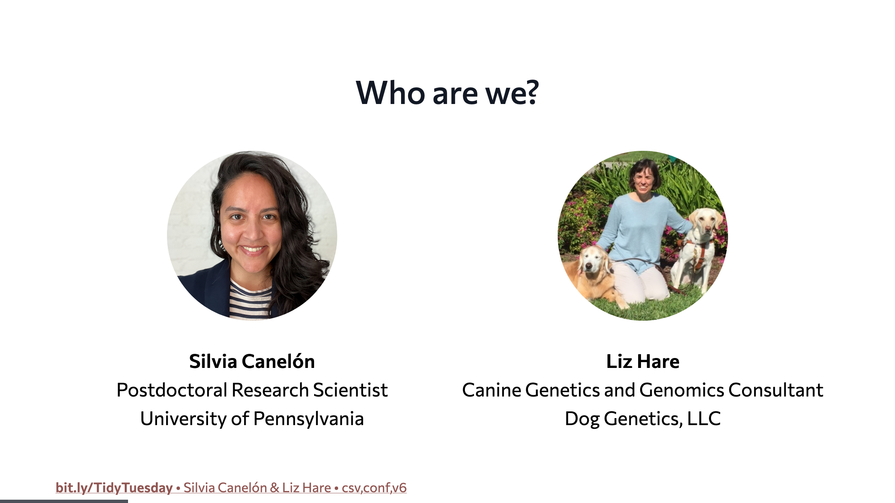{fig-alt=""}

**Silvia:**

My name is Silvia Canelón. I'm a postdoctoral research scientist at the University of Pennsylvania, where I use the R programming language to analyze electronic health record data.

**Liz Hare:**

I'm Liz Hare, and I've been working with R for about 15 years to do working dog genetics and genomics data analysis, and I met Silvia in MiR which is an organization of people from minority backgrounds working together to make our better space for everybody. 

Silvia had this [...] interest in data accessibility and she had an idea that she wanted to scrape up the information that was being generated by the TidyTuesday project so that we could see how often descriptive text was being added, so that blind people could follow the data regulations.

## Takeaways

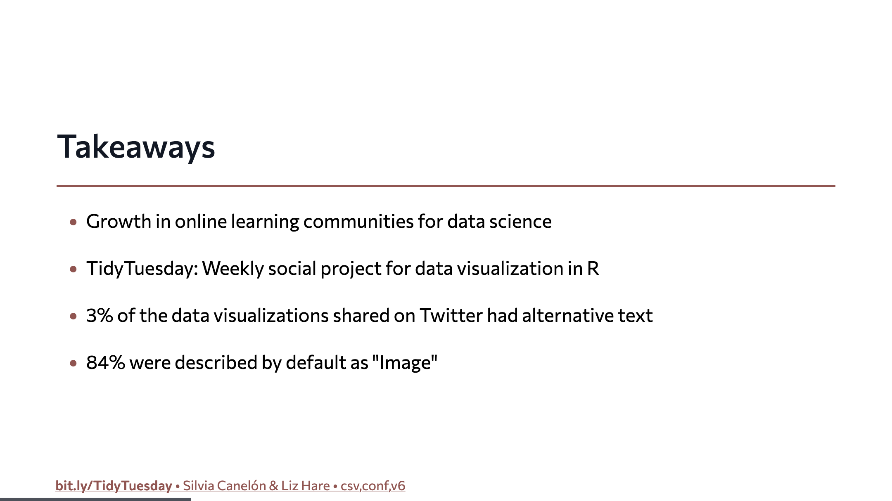{fig-alt=""}

**Liz:**

There are a lot of online learning communities around R and other data science software mediated in places like Twitter and Slack that are very supportive and people are really enjoying participating. TidyTuesday is a specific data visualization project using the tidyverse packages in the R open source statistical practice programming language.

We found that 3% of the tweaks displaying data visualizations had alt text which would describe the contents of the data visualization in a way that could be read by a screen reader. 

84% were described as image which was just the default placeholder when the user didn't enter anything. 

## Can blind people participate in data viz learning communities?

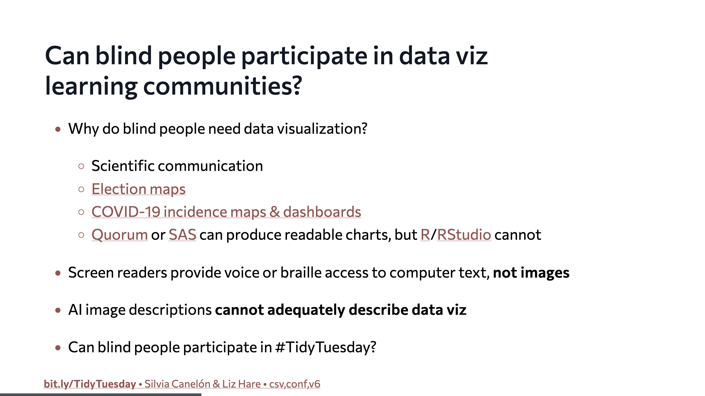{fig-alt=""}

**Liz:**

So we're still wondering about how blind people can participate in these data science learning communities. 

You may be asking why blind people need access to data visualization. I know that there are people who think that it's a form of communication that can't be transmitted in any other way, but most of the time it does need to be.

- There are blind scientists who need to be able to access read the scientific literature and contribute to it and present their work. 

- There are more general applications and current events, things like [election maps](https://fossheim.io/writing/posts/accessible-dataviz-us-elections/) and public health. We all would like to be able to have access to knowing the [COVID infection rates](https://www.theguardian.com/society/2020/sep/30/visually-impaired-scots-get-sonic-help-with-covid-graphs) in the communities around us. 

- There are some statistical software packages like [Quorum](https://quorumlanguage.com/evidence.html) and [SAS](https://documentation.sas.com/doc/en/pgmsascdc/9.4_3.5/odsacoutput/n12hxbdrtzec6gn1k913nwfl9o4d.htm) that will use vector-oriented graphics to produce data visualizations that have aspects that can be grabbed by a screen reader, but [R](https://cran.r-project.org/) doesn't have any of that capability at this time. 

Screen reading software provides voice or braille access to text that's on the computer screen. It does not describe graphics. 

You may be familiar with artificial intelligence image descriptions that are provided newly by some operating systems and Facebook and LinkedIn. These processes have not been developed enough that they could meaningfully describe data visualizations.

So then we wondered specifically about TidyTuesday and the ability of blind people to participate.

## What is TidyTuesday?

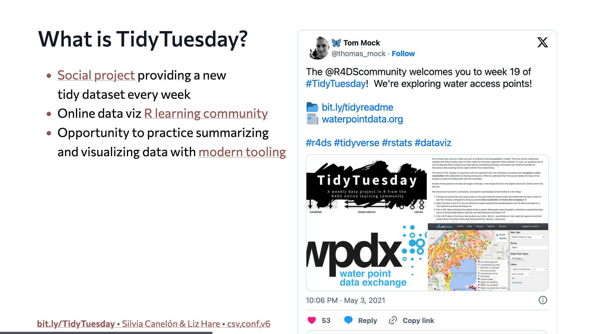{fig-alt=""}

**Silvia:**

As Liz had mentioned earlier, it's a [social project](https://github.com/rfordatascience/tidytuesday) that happens on a weekly basis and it's part of a broader online [R learning community](https://www.rfordatasci.com/). It provides participants an opportunity to practice summarizing and visualizing data with [modern tooling](https://www.rfordatasci.com/) like the tidyverse set of packages. 

On the right-hand side of the screen is an embedded tweet, which is an invitation for people to participate on Twitter every week. This tweet was sent out by Tom Mock, who leads the social project. He sent this out last night in preparation for today, which is Tuesday. And so we can see that the tweet includes information about the data set and where it comes from, about the project itself, and includes some relevant links that people can follow.

## What do #TidyTuesday visualization tweets include?

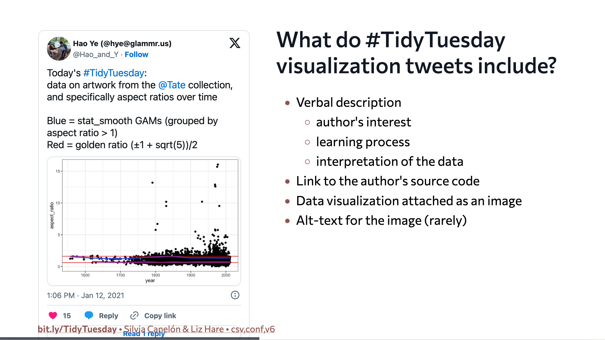{fig-alt=""}

**Silvia:**

On the left-hand side is an embedded tweet showing an example of what one of these, what we're calling TidyTuesday submissions or data visualization shares, what they might look like and what they might include. 

In the body of the tweet itself, there might be a verbal description. Maybe the author shares their interest in the data or what they found. Maybe they share something about their learning process. Maybe they tried a new function or a new package. They may also choose to include some interpretation of the data as well. It can vary. The tweet can also include a link to the author's source code, which is another really important aspect of the social project as participants are encouraged to share their code openly so that others may learn from the process that went into creating the data visualization and then reproduce it or modify it for their own needs.

And then of course the tweet will generally have an image attached of the data visualization that was created, but rarely do these images have text descriptions or alt text attached to them.

## How were the data collected?

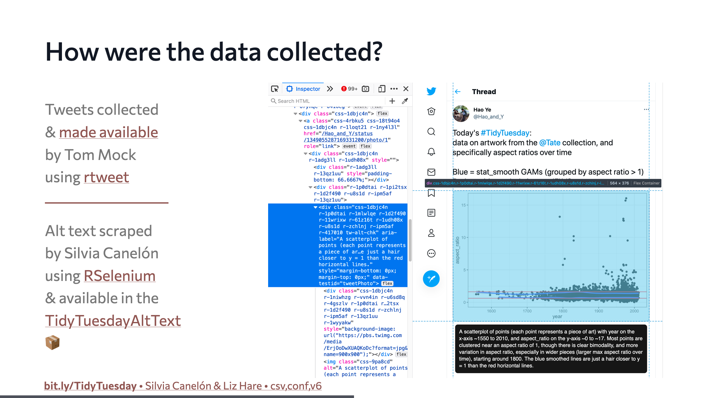{fig-alt=""}

**Silvia:**

The tweets for TidyTuesday have been collected over time since April of 2018, which is when this project started. Tom Mock has been collecting that data, and he makes them available in the [TidyTuesday repository](https://github.com/rfordatascience/tidytuesday). He collected this information using the [rtweet package](https://docs.ropensci.org/rtweet/) from ROpenSci. And so what I did then was I used that data to identify links for each individual tweet and did some processing and used the [RSelenium package](https://docs.ropensci.org/RSelenium/), also from ROpenSci, to scrape the alt text attribute that corresponded to the image in each of those tweets.

The right-hand side now shows a screenshot of what it looks like for me if I'm in my browser in Firefox and I open up my web inspector, if I'm looking at the tweet that I shared in the last slide, you can see that on the left-hand side there's some HTML code that corresponds to that tweet. And so the way that RSelenium helped me in this process was essentially running a browser that would travel to each of these individual tweets, find the picture, find the image that was attached and then scrape that alt text attribute. 

In this particular screenshot, we can also see the alt text for the image underneath the image itself in a block of text. That's visible to us because there are certain extensions you can install in your browser that let you see the alt text for different images. That's what is showing up here.

## What did we find?

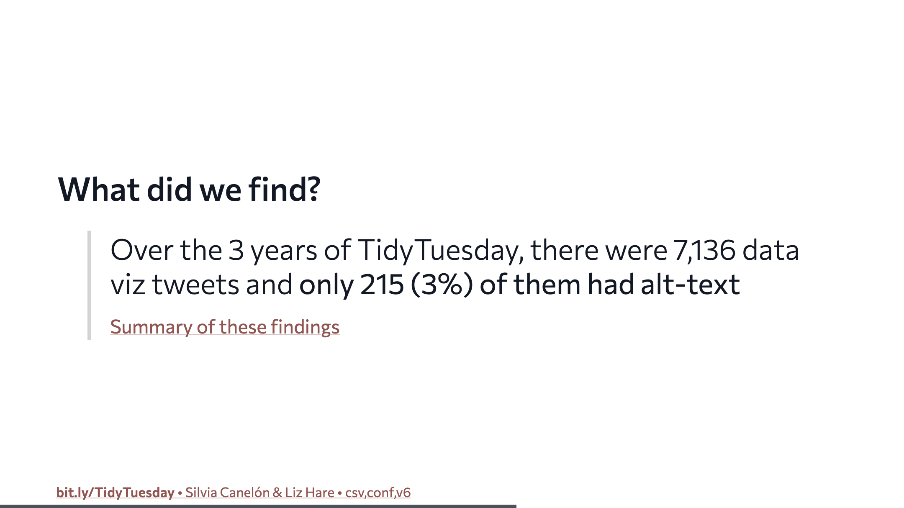{fig-alt=""}

**Silvia:**

So what did we find after scraping? 

We found that over the three years of the TidyTuesday project, there were over 7000 data viz tweets and only 215 or 3% of them had alt text.

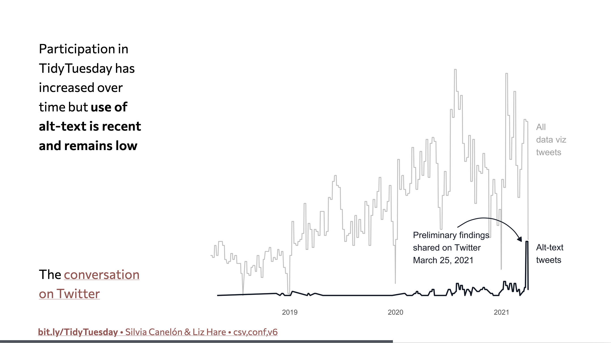{fig-alt=""}

Participation in TidyTuesday has increased over time, but as we can see from these line graphs, the use of alt text is recent and remains really low. What we see on the right hand side is a line graph where there's a gray line corresponding to all the tweets submitted as part of this project over time. Then there's another line that is a darker color and it shows which of those tweets also have alt text attached to them. 

We can see that for the most part there has been increased participation in the project over time, but there hasn't been much change in how alt text is used in this context except for at the end where we see this spike. That spike corresponds to a [conversation on Twitter](https://twitter.com/spcanelon/status/1375222124365946881?s=20), when Liz and I found out we would be presenting at this talk today, and there was some conversation about our preliminary findings and some changes that were implemented because of that.

## Where else is alt-text missing?

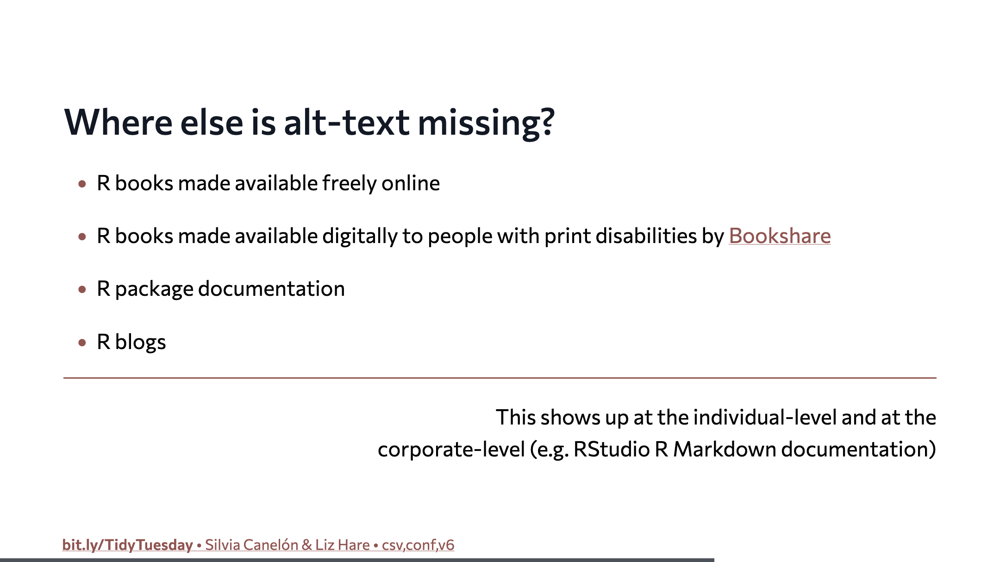{fig-alt=""}

**Silvia:**

So Liz, could you tell us where else alt text is missing in in addition to this project?

**Liz:**

Yeah, there's a lot of free open source material, books and tutorials available on the internet and they're all wonderfully searchable by Google so that you can answer the questions you have while you're coding. But many of them are lacking all texts for their data visualization and also sometimes even display code as PNG images which can't be read by a screen reader.

This problem is also found with Bookshare, which is a nonprofit that provides access to electronic books for people with print disabilities. They work with publishers who often also don't provide alt text for images. They don't provide it themselves. And again, sometimes the actual code snippets are missing from those books and manuals.

Some R package documentation has data visualizations in it to show you how these interesting new tidyverse kinds of graphs look and come out. And it's really difficult to figure out if someone who's trying to display data and you can't see what the code actually produces.

There are also a lot of R blogs that have educational components but again, are lacking all text or lacking access to the code.

This happens both at the individual level as we mentioned with things like blogs and also at the corporate level where RStudio's documentation on their websites is often missing these accessibility features.

## What makes good alt text?

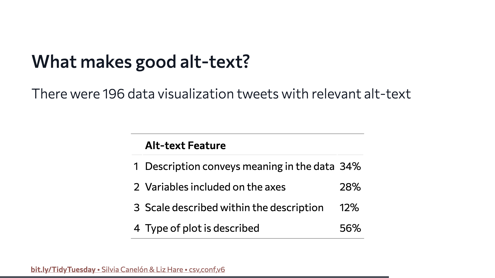{fig-alt=""}

**Liz:**

Once we had scraped these alt texts, one of the things we were interested in asking is what about them makes them good and what about them makes them effective. Based on my experience online and reading media, and also going through each of the alt texts that Silvia scraped.

The first item that I felt was really important was that something is shared about what the data is showing, what is the meaning being conveyed. 34% included that.

28% included a description of what variables were on the axes of the data visualization.

12% had some indication of the scale of the axes or a way to find out what the scale was from the description of the data.

This one is pretty important too. You need to tell us what kind of graph it is. Is it a line plot? Is it a scatter plot? Is it a QQ plot or residual plot? And 56% provided that. I'd like to also add that there are a lot of really cool modern, new, and also some very specialized kinds of graphics, especially within tidyverse. If you're using something that's a little less common, it would be really good to provide some orientation to how the data visualization works and what it's saying.

## Has the tide started shifting?

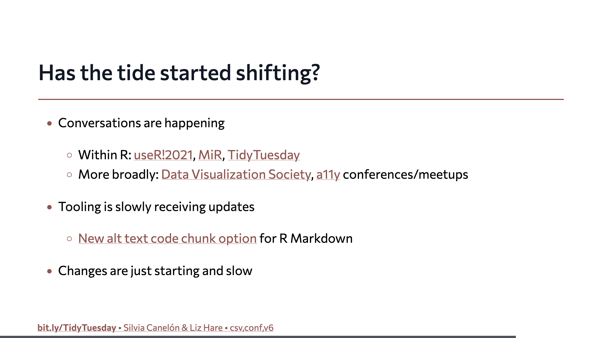{fig-alt=""}

**Silvia:**

We saw in the line graph a couple of slides ago that there seems to be something changing now, so we wanted to ask, has the tide started shifting? Are we noticing changes outside of this as well?

We know that conversations are happening within R in different spaces. 

- One great example is the [useR conference](https://user2021.r-project.org/participation/accessibility/) that's happening this year that Liz is a part of and one of the organizer volunteers for. The conference itself has been very intentional about centering accessibility practices into the conference in terms of how it's delivered in a way that makes it as accessible as possible for participants that are attending as speakers or that are just attending to participate in the different talks and tutorials.
- The[MiR community](https://mircommunity.com/about/) is also a space where we're having these conversations like the one we're having today. There's an accessibility committee within that community that Liz and I are part of and where we regularly meet and discuss these things. 
- Within TidyTuesday in particular, when we shared our preliminary findings on Twitter, the leader of the social project, Tom Mock, was able to add a whole section to the [TidyTuesday repository](https://themockup.blog/posts/2021-04-01-three-years-of-tidytuesday/) inviting and encouraging participants to include alt text in the data visualizations that they share on Twitter. It includes resources as well for participants and have a place to start from.

More broadly, we also have noticed conversations happening in other places. 

- The [Data Visualization Society](https://www.outlierconf.com/) had a conference earlier this year, Outlier Conf, that featured a few different talks about data accessibility.
- A variety of [A11Y](https://www.a11yproject.com/) conferences and meetups also are having these conversations.

There's also some change happening with tooling within R. One good example is that within RMarkdown, which is very popular, there is now the ability to [add alt text as an option to a code chunk](https://blog.rstudio.com/2021/04/20/knitr-fig-alt/), so that whatever graphical output that code chunk is producing, it can come equipped with alt text as well. In the same way that one might add a figure caption, now we can also add an alt text tag to that graphical output.

But it is important to note that these changes are great but they are just starting and they're slow.

## What can you do?

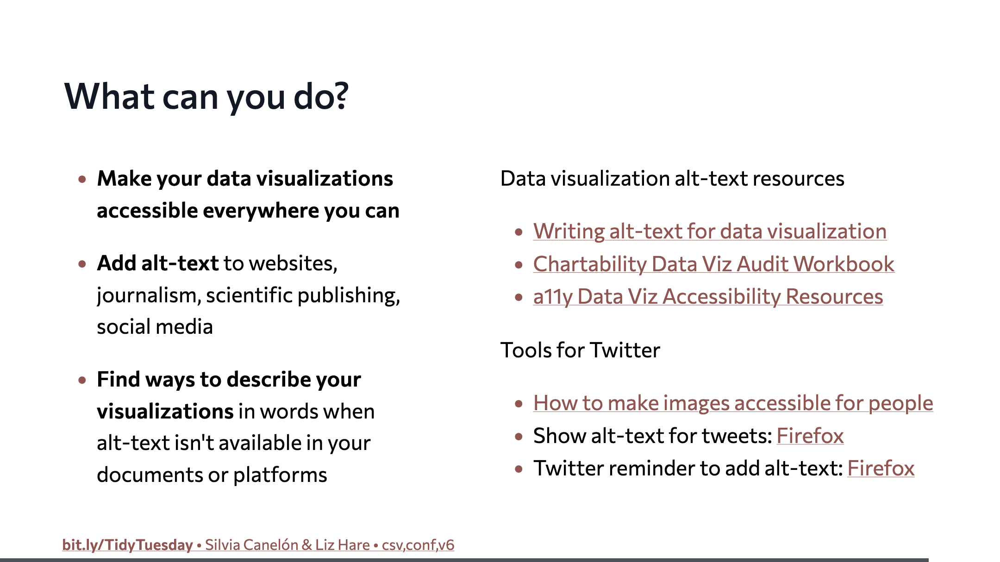{fig-alt=""}

You can make your data visualizations accessible everywhere that you can.

This includes adding alt text to websites, journalism, scientific publishing, social media and other spaces.

In situations where alt text isn't available in your particular document or platform, try to find creative ways to describe your visualizations and words.

Liz and I have provided a short list here of some resources, including:

- A great [blog post by Amy Cesal](https://medium.com/nightingale/writing-alt-text-for-data-visualization-2a218ef43f81)
- The new [Chartability Data Viz Audit Workbook by Frank Elavsky](https://chartability.fizz.studio/)
- Another [resource from the A11Y community](https://github.com/dataviza11y/resources/blob/main/README.md)

And a few links specific to Twitter:

- [How do I add alt text to the images that I attach?](https://help.twitter.com/en/using-twitter/picture-descriptions)
- [How can I see the alt text if I want to? What kind of extensions are available?](https://addons.mozilla.org/en-US/firefox/addon/alt-or-not/)
- [Are there extensions available to help me remember to attach alt text to my images?](https://addons.mozilla.org/en-GB/firefox/addon/twitter-required-alt-text/) There's a resource for that too, specific to Firefox, but other browsers will have them as well. 

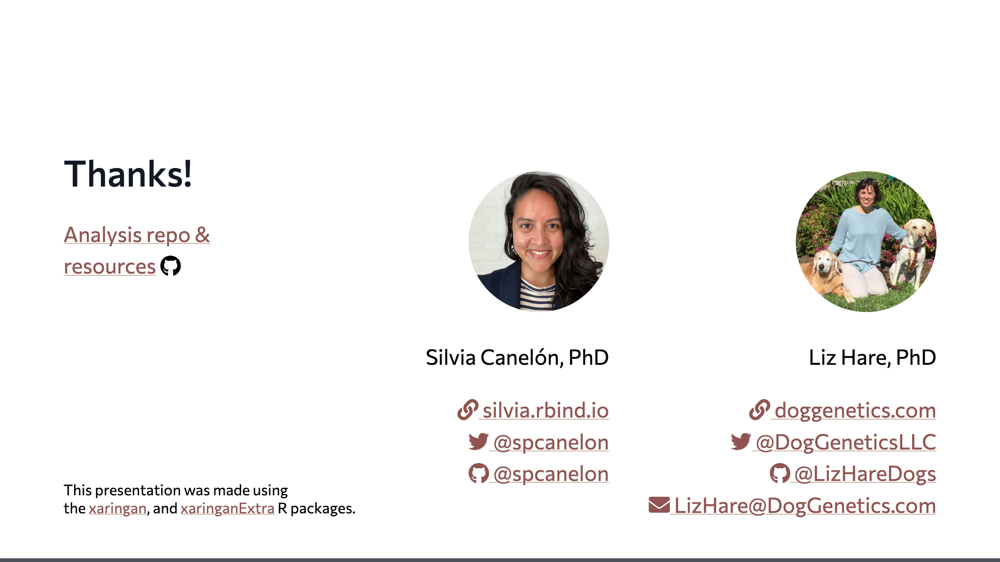{fig-alt=""}

**Silvia:**

Thanks so much! [Resources, Liz's analysis, and also a link to the TidyTuesdayAltText package](https://github.com/spcanelon/csvConf2021) that we used for this analysis are available in the link on this slide.

Thanks so much, we're excited to take some questions. 

## Q&A

**Event host:**

Fantastic. Thank you so much for sharing this amazing and important work that you've been doing and tips for us all to do better.

There's a lot of questions, but I think we only have time for one. Jess asks, are there any good resources for testing what the screen reader experience is like for people, or accessibility in general?

**Silvia:** 

I think a great place to explore would be some of those A11Y resources. A11Y stands for "accessibility," and there's a lot of conversations there that happen within the context of web development. User testing and screen reader testing are part of that full process. So I would encourage folks to check out some of those resources.