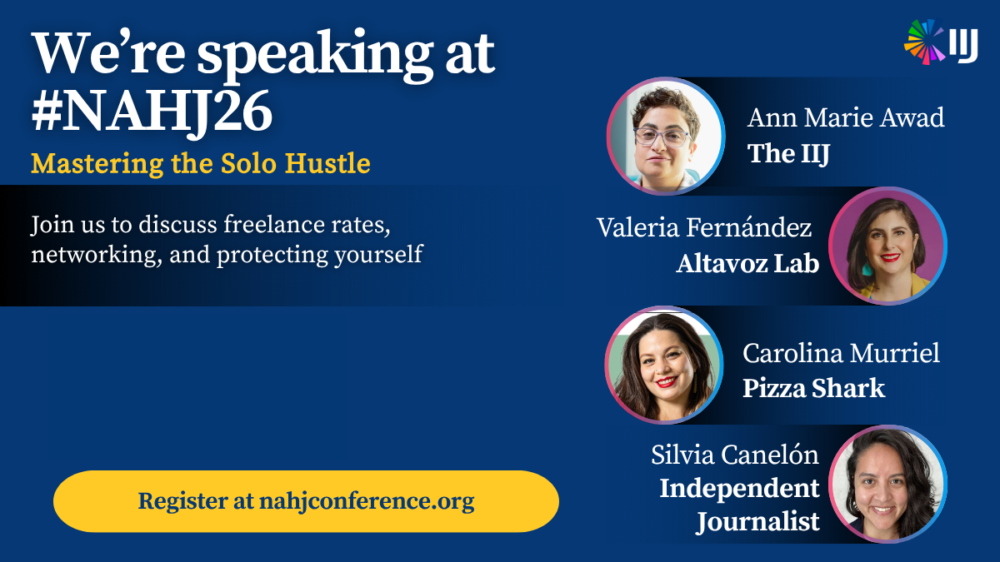

**What:** Panel discussion with independent journalists [Ann Marie Awad](https://www.linkedin.com/in/annawad/) and [Carolina Murriel](https://www.linkedin.com/in/carolinamurriel/), moderated by [Valeria Fernández](https://www.linkedin.com/in/valeria-fernández-altavozlab/). I had the pleasure of delivering a brief presentation on a research project on philanthropy funding for journalism, spearheaded by the [Institute for Independent Journalists](https://theiij.com).

**Description:** Independent journalists are on the rise. As layoffs continue to reshape the news business, independents are building their own platforms from scratch – and earning money while doing it. But those who go it alone need to build sustainable systems to avoid burnout. This session covers business basics for freelancers and creator journalists, including how to determine fair rates, manage time, network with intention and protect your intellectual property.

{fig-alt="Graphic that says 'We're speaking at #NAHJ26. Mastering the Solo Hustle. Join us to discuss freelance rates, networking, and protecting yourself. Register at nahjconference.org' It also features the 4 panelists on the right hand side, Ann Marie Awad (The IIJ), Valeria Fernández (Altavoz Lab), Carolina Murriel (Pizza Shark), and me, Silvia Canelón (Independent Journalist). The IIJ logo is features in the top right."}