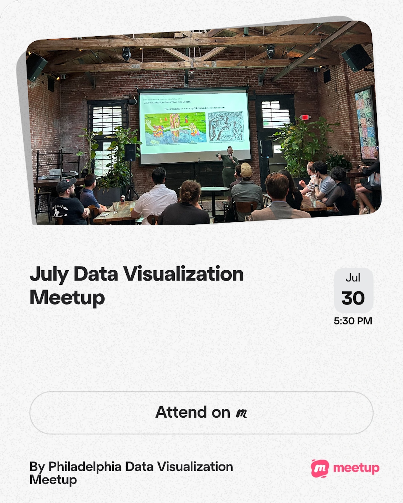

Brief talk about data visualization to share public-facing data visualization projects (see links below!) and share preliminary research on the state of philanthropic funding in journalism.

# Resources

- [TidyTuesday R data viz database](https://tiny.cc/notion-dataviz) on Notion
- [The lack of accessibility in the TidyTuesday learning community](/talk/2021-05-04-data-viz-accessibility/)
  - My collaborator [Liz Hare](https://www.linkedin.com/in/liz-hare-phd-1a50925/) authored a chapter in the Urban Institute's Do No Harm Guide on Centering Accessibility in Data Visualization. The chapter is titled [Writing Alt Text to Communicate the Meaning in Data Visualizations](https://www.urban.org/sites/default/files/2022-12/Do%20No%20Harm%20Guide%20Centering%20Accessibility%20in%20Data%20Visualization.pdf#Chapter%204). Check it out!
- Interactive [Center City District SIPS Map](/project/2024-06-16-ccd-sips/)
- Graphics for [Kensington Voice accountability piece](https://web.archive.org/web/20260123165537/https://www.kensingtonvoice.com/new-fast-track-court-for-kensington-lands-most-with-warrants-back-into-the-cycle-of-addiction-and-homelessness/)
- Upcoming report on [philanthropic funding for journalism](https://theiij.beehiiv.com/)

[{width=50% fig-alt="July Data Visualization Meetup, July 30th 5:30pm, By Philadelphia Data Visualization Meetup. Attend on Meetup. Features a photo of a person presenting visuals on a slide, in a brick-walled event space." fig-align="center"}](https://www.meetup.com/philadelphia-data-visualization-meetup/events/315564097/?eventOrigin=group_past_events)